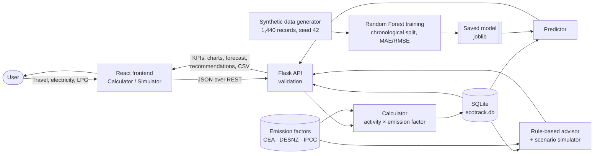

# EcoTrack AI — Environmental Technology Assignment

## 1. Selected Environmental Problem
**Personal Carbon Footprint**

Everyday choices — how we travel, how much electricity we use at home, and what fuel we cook with — release greenhouse gases that drive climate change. Most people have no idea how large their own footprint is, which activities matter most, or which changes would make the biggest difference. Without that feedback it is hard to change habits.

## 2. Proposed Digital Solution
**EcoTrack AI – Personal Carbon Footprint Prediction and Reduction System**

A web application that:
1. **Calculates** a person’s monthly carbon footprint from simple inputs (travel distances, electricity units, LPG use) using published emission factors.
2. **Predicts** next month’s emissions with a trained machine-learning model (Random Forest).
3. **Recommends** the changes that would save the most CO₂e, with a what-if simulator so users can see the effect before acting.
4. **Tracks** progress over time with history, charts, month comparison and CSV export.

## 3. Technologies Used
- **React** (with Vite) — user interface
- **Tailwind CSS** — styling; **Framer Motion** — animations; **Lucide** — icons
- **Recharts** — charts
- **Flask** (Python) — REST API
- **Python** — calculation, recommendation and data logic
- **SQLite** — local database (`ecotrack.db`)
- **Scikit-learn** — Random Forest Regressor
- **Pandas / NumPy / Joblib** — data handling and model storage

## 4. Input Data and Sources

### 4.1 User inputs (per month)
| Input | Unit | Notes |
|---|---|---|
| Vehicle type | car / no car | |
| Car fuel type | petrol / diesel / electric | |
| Car distance | km/month | |
| Two-wheeler distance | km/month | optional |
| Public transport distance + mode | km/month, bus or metro/rail | |
| Electricity consumption | kWh/month | from the electricity bill |
| Renewable electricity share | % | optional (rooftop solar, green tariff) |
| Household members | people | electricity & LPG are shared equally |
| LPG consumption | kg/month | 1 domestic cylinder = 14.2 kg |

### 4.2 Emission-factor sources
| Activity | Value | Source (year) |
|---|---|---|
| Indian grid electricity | 0.727 kg CO₂/kWh | Central Electricity Authority, CO₂ Baseline Database for the Indian Power Sector v20.0, weighted average FY 2023-24 (2024) |
| Petrol car | 0.1645 kg CO₂e/km | UK DESNZ Greenhouse gas reporting: conversion factors (2024) |
| Diesel car | 0.16984 kg CO₂e/km | UK DESNZ/DEFRA conversion factors (2023) |
| Motorbike / scooter | 0.11367 kg CO₂e/km | UK DESNZ conversion factors (2024) |
| Bus | 0.10846 kg CO₂e/passenger-km | UK DESNZ/DEFRA conversion factors (2023) |
| Rail / metro | 0.03546 kg CO₂e/passenger-km | UK DESNZ/DEFRA conversion factors (2023) |
| LPG | 2.985 kg CO₂/kg | Derived from IPCC 2006 Guidelines, Vol. 2 Ch. 1 default factors |
| Electric car energy use | 0.15 kWh/km | **Illustrative assumption** (clearly labelled in the app) |

Limitations: transport factors are UK averages used as a proxy for India; the CEA grid factor covers CO₂ only and is a national average.

### 4.3 Synthetic training data (for the ML model only)
- Generated automatically by `backend/ml/synthetic.py` with a fixed random seed (42), so it is reproducible.
- 60 imaginary users × 24 months = **1,440 monthly records**, each with user ID, month, electricity, car, two-wheeler and public-transport distance, LPG, previous month’s emissions and the next month’s emissions (target).
- Includes Indian seasonal patterns (summer AC peak), slow personal trends, random month-to-month variation and occasional one-off events.
- Stored as CSV files, **completely separate** from the user’s real records in the database.

## 5. Input → Processing → Output

**Input:** monthly activity data entered in the calculator (or demo records).

**Processing:**
1. The Flask API validates the inputs (numbers, ranges, month format).
2. Emissions are calculated: *activity × emission factor*, with electricity/LPG divided by household size.
3. The record and its results are saved to SQLite.
4. The trained Random Forest uses this month’s activities, this month’s and last month’s totals and the season to predict next month’s emissions.
5. Rule-based logic ranks reduction actions by estimated saving; the simulator recalculates emissions under user-chosen changes.

**Output:** monthly and annual footprint, category breakdown, largest contributor, next-month forecast with model metrics, ranked recommendations, scenario savings, history charts and CSV export.

## 6. Environmental Benefits
1. **Awareness of hidden emissions** — users see, in kg CO₂e, how much each activity contributes, turning an abstract problem into a personal number.
2. **Targeted action** — recommendations are ranked by estimated saving, so effort goes to the changes with the biggest impact (often car travel or electricity) rather than symbolic ones.
3. **Encourages lower-carbon transport** — the simulator shows the concrete saving from shifting car trips to bus or metro, supporting reduced fuel use and urban air pollution.
4. **Supports energy efficiency and renewables** — users can quantify the effect of efficient appliances, better AC habits and rooftop solar/green tariffs on their footprint.
5. **Habit tracking over time** — monthly history and forecasts help users notice rising trends early and keep reductions going, which matters more than one-off changes.

## 7. Prototype Link
- **Deployed website:** _[add your deployed URL here]_
- **GitHub repository:** _[add your repository URL here]_

(Run locally by following the instructions in `README.md`.)
