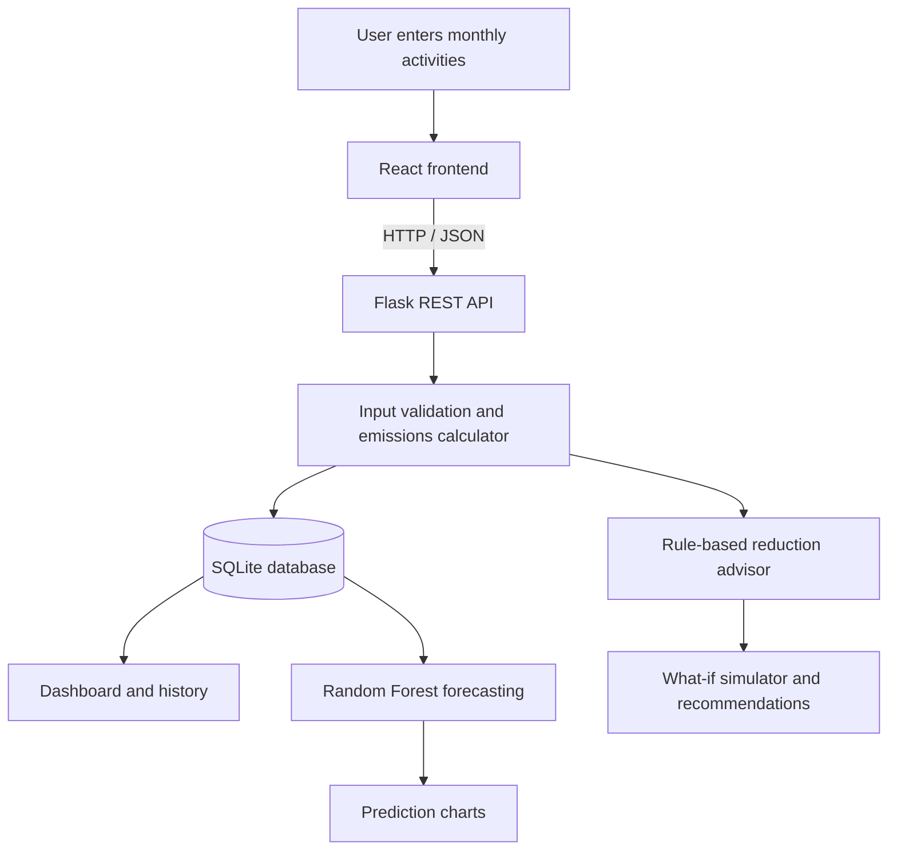

# EVS_PROJECT

🌿 EcoTrack AI
Intelligent Personal Carbon Footprint Prediction & Reduction Platform
A full-stack environmental analytics application combining carbon accounting, machine learning, and explainable reduction guidance.
Project overview
Environmental problem: Personal Carbon Footprint
Solution: An interactive web application for estimating, forecasting, and reducing personal greenhouse gas emissions.

A full-stack college environmental-technology project. Users log a month of travel, electricity and cooking fuel; EcoTrack calculates the carbon footprint with published emission factors, forecasts next month with a trained Random Forest model, and suggests ranked, explainable ways to cut emissions.
Local demo application. There is no login. All data belongs to one local Demo User and is stored in backend/ecotrack.db on your computer. On first run the app adds 12 months of clearly labelled demo records.

Problem statement
Everyday activities such as vehicle travel, household electricity use, and cooking fuel consumption contribute to greenhouse gas emissions. Individuals often lack an accessible way to quantify these emissions, understand their largest sources, and explore practical changes. EcoTrack AI addresses this awareness and decision-support gap through a transparent emissions calculator, historical analysis, an experimental ML forecast, and an interactive reduction simulator.
Objectives
- Estimate monthly personal greenhouse gas emissions in kg CO₂e using documented activity-specific factors.
- Identify which activities contribute most to a user's estimated footprint.
- Store and compare historical activity and emissions records in a local SQL database.
- Demonstrate next-month emissions forecasting with a trained Random Forest regressor.
- Offer actionable, explainable reduction recommendations and scenario estimates.
- Present the results in an accessible, responsive dashboard.
System workflow

Input → Processing → Output: Monthly transport, electricity and LPG values → validation, emissions calculation, database storage, optional ML prediction and scenario analysis → totals, breakdowns, historical charts, forecasts and reduction guidance.
Features
Page	What it does
Landing	Premium marketing page with live model metrics, a factor comparison and an interactive dashboard preview (both read the real API).
Dashboard	4 KPIs, area trend, donut breakdown, electricity-vs-transport bars, actual-vs-predicted line, largest contributor, insights, monthly comparison, recent activity, top recommendations.
Calculator	4-step form (transport → electricity → cooking → results) with a live estimate from the backend; save to any month (with replace-if-exists).
AI Prediction	Next-month forecast, historical vs predicted chart, back-test, MAE/RMSE/R², baseline comparison, feature importance, limitations, saved forecasts.
Reduction Advisor	Ranked rule-based tips with visible formulas + interactive simulator (car cut, shift to public transport, electricity, LPG, renewables).
History & Analytics	Month / range filters, stacked category chart, trend, compare any two months, delete records, CSV export, restore demo data.
Methodology	Every emission factor with source, year, unit and caveats.

Real-world applications
- Individuals: Understand emissions associated with commuting and household activities.
- Households: Explore energy and fuel-use reduction scenarios.
- Students and educators: Demonstrate emissions accounting, AI/ML, and sustainability concepts.
- Environmental awareness campaigns: Illustrate how behavior changes could affect emissions.
- Research prototypes: Test model and interface ideas before collecting real longitudinal data.
The current application is a single-user local demo, not a multi-tenant carbon accounting service.
Expected environmental benefits
1. Improves awareness of everyday greenhouse gas emissions.
2. Encourages electricity conservation and efficient appliance use.
3. Promotes lower-emission travel choices.
4. Helps users identify high-impact reduction opportunities.
5. Supports ongoing monitoring of sustainability goals.
These are potential benefits, not measured real-world reductions.
Tech stack
- Frontend: React 18 + Vite, Tailwind CSS, Framer Motion, Recharts, Lucide icons, React Router
- Backend: Python 3.11+, Flask, Flask-CORS, SQLite
- ML: scikit-learn RandomForestRegressor, pandas, NumPy, joblib
Database and data sources
- SQLite (backend/ecotrack.db): Local storage for the demo user, activity records, calculated results, factors, predictions and recommendations. The database is initialized automatically.
- Demo activity records: Twelve preloaded months are created for first-time exploration. These are sample records, not observations from real users.
- Synthetic ML dataset: Generated locally by backend/ml/synthetic.py; it is used to demonstrate model training and evaluation.
- Emission factors: Defined with source information and assumptions in backend/factors.py, then exposed through the Methodology page and API. Factors should be reviewed before real-world use, especially where non-Indian transport values are used as approximations.
Run it on Windows (PowerShell, VS Code)
You need Python 3.11+ (tick “Add python.exe to PATH” when installing) and Node.js 18+ (LTS).

Open the ecotrack-ai folder in VS Code, then open two terminals (Terminal → New Terminal).
Terminal 1 — backend
cd backend
powershell -ExecutionPolicy Bypass -File .\setup.ps1   # first time only (venv, packages, database, demo data, model)
powershell -ExecutionPolicy Bypass -File .\run.ps1     # starts the API on http://127.0.0.1:5000
Check it works: open http://127.0.0.1:5000/api/health in your browser.
Terminal 2 — frontend
cd frontend
npm install        # first time only
npm run dev
Open http://localhost:5173. Keep both terminals running.
Manual backend setup (if you prefer not to use the scripts)
cd backend
python -m venv .venv
.\.venv\Scripts\Activate.ps1
pip install -r requirements.txt
python init_all.py          # database + demo data + synthetic dataset + training
python app.py
Useful commands
Command (inside backend, venv active)	Purpose
python init_all.py --reset	Rebuild demo records from scratch and retrain
python -m ml.train	Regenerate synthetic data and retrain the model only
python -m pytest -q	Run the test suite

The app also self-initialises: if ecotrack.db or the model file is missing when app.py starts, it creates/trains them automatically.
Project structure
ecotrack-ai/
├── README.md, ASSIGNMENT.md
├── backend/
│   ├── app.py              Flask REST API (all routes)
│   ├── db.py               SQLite schema + connection (foreign keys, constraints)
│   ├── factors.py          Emission factors with sources -> emission_factors table
│   ├── calculator.py       Validation + emissions = activity x factor
│   ├── advisor.py          Rule-based recommendations + scenario simulator
│   ├── insights.py         Plain-language insights from saved records
│   ├── repository.py       Parameterised database queries
│   ├── seed_demo.py        12 months of labelled demo data
│   ├── init_all.py         One-step setup
│   ├── ml/
│   │   ├── synthetic.py    Synthetic dataset generator (seeded)
│   │   ├── train.py        Chronological split, training, MAE/RMSE
│   │   ├── predictor.py    Forecast + back-test on the user's records
│   │   ├── data/           (generated) CSV datasets
│   │   └── models/         (generated) model file + metrics JSON
│   ├── tests/              pytest suite (19 tests)
│   ├── setup.ps1, run.ps1, requirements.txt
└── frontend/
    ├── src/
    │   ├── lib/api.js      Central API service
    │   ├── components/     layout (sidebar/navbar), ui (cards, buttons, modal, toasts…), charts
    │   └── pages/          Landing, Dashboard, Calculator, Predict, Advisor, History, Methodology
    └── vite.config.js      Dev proxy /api -> Flask
API
Method	Route	Description
GET	/api/health	API + model status
GET	/api/dashboard	All dashboard data computed from DB records
POST	/api/calculate	Calculate without saving
POST	/api/activities	Calculate and save a month (replace: true to overwrite)
DELETE	/api/activities/<id>	Delete a record
GET	/api/history?month=&from=&to=	Records + summary
GET	/api/export	CSV download
GET	/api/predictions	Model card, forecast, back-test, saved forecasts
POST	/api/predict	Run the model and store the forecast
GET	/api/recommendations	Ranked tips for the latest month
POST	/api/simulate	What-if scenario
GET	/api/emission-factors	Factors with sources
POST	/api/demo/reset	Restore demo records

Validation errors return 422 with per-field details; duplicates 409; missing records 404; model not trained 503. All SQL is parameterised.
How the calculation works
Emissions (kg CO₂e) = Activity data × Emission factor
Activity	Factor	Source
Grid electricity (India)	0.727 kg CO₂/kWh	CEA CO₂ Baseline Database v20.0, FY 2023-24 (2024)
Petrol car (average)	0.1645 kg CO₂e/km	UK DESNZ conversion factors 2024
Diesel car (average)	0.16984 kg CO₂e/km	UK DESNZ/DEFRA conversion factors 2023
Electric car	0.15 kWh/km × grid factor	Illustrative assumption
Motorbike/scooter	0.11367 kg CO₂e/km	UK DESNZ 2024 (0.18293 kg/mile)
Bus	0.10846 kg CO₂e/passenger-km	UK DESNZ/DEFRA 2023
Rail/metro	0.03546 kg CO₂e/passenger-km	UK DESNZ/DEFRA 2023 (national rail)
LPG	2.985 kg CO₂/kg	Derived from IPCC 2006 defaults (63,100 kg/TJ × 47.3 TJ/Gg)

Household vs individual: electricity and LPG are divided by the number of household members, so results are one person’s allocated share. Transport is per person.
How the ML works (honestly)
- 60 synthetic users × 24 months = 1,440 monthly records (seed 42), with seasons, personal trends, AR(1) noise and occasional events.
- Each example: features known at the end of month t → total emissions of month t+1. No target leakage.
- Chronological split: train on target months 2024-03 → 2025-06, test on 2025-07 → 2025-12.
- Example evaluation reported in the original project documentation (re-run training to verify locally): MAE 16.37, RMSE 25.35, R² 0.937 (unitless) vs a naive “same as this month” baseline of MAE 18.15 / RMSE 30.18.
- Most of the model’s weight is on this month’s total (persistence), with season and last month adding the rest — a realistic outcome for monthly footprints.
- This is a synthetic-data demonstration. Scores do not prove real-world accuracy.
Testing
cd backend
.\.venv\Scripts\python.exe -m pytest -q
Covers formula correctness (hand-checked numbers), validation, the simulator maths, every API route, SQLite CRUD, empty states, and ML data integrity (≥1,000 rows, chronological split, no leakage, deterministic seed).
GitHub repository setup
From the project root, after creating an empty repository on GitHub:
git init
git add .
git commit -m "Initial commit: EcoTrack AI"
git branch -M main
git remote add origin https://github.com/YOUR_USERNAME/ecotrack-ai.git
git push -u origin main
Before git add .: Create a .gitignore and exclude generated environments and data such as frontend/node_modules/, frontend/dist/, backend/.venv/, __pycache__/, .pytest_cache/, *.pyc, backend/ecotrack.db, backend/ml/models/, and generated datasets if they can be recreated by setup scripts. Never commit credentials or private user records. Keep package-lock.json, requirements.txt, source code, documentation and setup scripts under version control.

Repository URL: Add your actual GitHub URL here after publishing.
Live demo: Add a public URL only after successfully deploying and testing both frontend and backend. localhost is not a public demo link.
Deploying (optional)
- Frontend: npm run build → upload frontend/dist to Netlify/Vercel. Set VITE_API_URL to your backend URL + /api before building.
- Backend: any Python host (e.g. Render/Railway free tier): pip install -r requirements.txt then python app.py (or gunicorn app:app). SQLite on free hosts may reset on redeploy — fine for a demo.
Troubleshooting
- “running scripts is disabled” → use the powershell -ExecutionPolicy Bypass -File ... form shown above.
- Frontend says “Cannot reach the EcoTrack API” → the backend terminal isn’t running; start run.ps1.
- Port 5000 busy → $env:PORT=5050; python app.py and change the target in frontend/vite.config.js.
Limitations and future improvements
Current limitations: Emissions are estimates based on selected factors; transport factors may not represent every Indian vehicle or route; the model is trained on synthetic records; the prototype has one local demo profile and no authentication. A locally running Flask server is not suitable as-is for public production deployment.

Future scope: Validate emission factors for more Indian travel modes; collect consent-based real historical activity data; retrain and evaluate on real observations; add authenticated profiles; support renewable energy and more household activities; deploy the frontend and API with persistent database storage.
License
No license is included in the supplied project archive. Add a LICENSE file if you want to grant others permission to reuse or modify the code.
